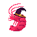
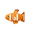
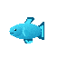
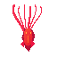
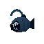
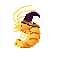

<div align="center">



# M I Z E R I L L I O N

**the daily dive for one group chat**

<sub>7 prompts · 25 seconds each · rarer answers sink deeper</sub>

<br>


</div>

```
 ~ ~ ~ ~ ~ ~ ~ ~ ~ ~ ~ ~ ~ ~ ~ ~ ~ ~ ~ ~ ~ ~ ~ ~ ~ ~ ~ ~ ~ ~ ~ ~ ~ ~ ~ ~ ~ ~ ~ ~ ~ ~
   0m   ·  the surface. everyone blurts the same thing up here.
```

## What is this?

A private, Krillion-style trivia game whose prompts come from **one group chat's own history**:
the names it's had, the words it overuses, the emoji it reacts with, who's always first to reply.

Every day there's one dive of **7 prompts**. You get **25 seconds** to name one thing for each.
Obvious answers float near the surface. Rare ones sink. Every point drops you **10 metres**, and
**700 is the trench**.

It's members only: one shared password gets you in, then you pick your name.

```
   .
   .    🫧
   .        🐟
  -150m              🦑
   .                       🏮
   .                                🌟
  -700m  ·  the trench. one in a mizerillion.
 ~ ~ ~ ~ ~ ~ ~ ~ ~ ~ ~ ~ ~ ~ ~ ~ ~ ~ ~ ~ ~ ~ ~ ~ ~ ~ ~ ~ ~ ~ ~ ~ ~ ~ ~ ~ ~ ~ ~ ~ ~ ~
```

## 🐟 The tiers

| | Tier | Points | |
|:-:|---|:-:|---|
|  | **Plankton** 🫧 | `10` | The answer everyone blurts out. |
|  | **Too Clever** 🤡 | `15` | The obscure answer the whole school thought of. |
|  | **Schooler** 🐟 | `30` | Solid — swims with the school. |
|  | **Rare** 🦑 | `60` | An uncommon answer. Nice pull. |
|  | **Deep Cut** 🏮 | `85` | True obscurity. Few go this deep. |
|  | **One in a Mizerillion** 🌟 | `100` | The designated gem. Trench floor. |

Wrong guesses cost nothing: you get *"no echo. try again"* and keep guessing until the clock runs
out. Typos get a "did you mean…?" to confirm. Emoji answers count too (❤ 🦭 😭).

## 🧭 How deep did you go?

| Score | Depth | You are… |
|---:|---:|---|
| 0–150 | 0–1,500 m | 🫧 **Plankton.** Plenty of ocean left down there. |
| 151–250 | to 2,500 m | 🐟 **Schooler.** Swimming with the school. |
| 251–350 | to 3,500 m | 🦑 **Rare.** Below the thermocline. Nice. |
| 351–449 | to 4,490 m | 🏮 **Deep cut.** Seriously deep dive. |
| 450–700 | to 7,000 m | 🌟 **One in a mizerillion.** Trench dweller. Absurd. |

After your dive you get the full answer sheet for every prompt, how you did against everyone else
who played that day, and a result to paste back into the chat:

```
Mizerillion #12 🦐
395/700 · 3950m
🌟🫧🦑🏮🐟🫧🌟
```

## 🦐 What's in the dive

- **One daily dive per person**, the same 7 prompts for everyone, new at midnight (Vancouver time).
- **Practice dives** whenever you like. They never count.
- **The server keeps the clock and the score.** Answers stay hidden until you finish.
- **Animated pixel ocean:** the boat, the descent, the sinking answer, the surfacing.
- **Sounds, low-power mode and colourblind mode**, built for phones first.
- **An admin page** to re-tier answers with one click, add prompts and answers, fix aliases from
  real wrong guesses, manage names, set the launch day, and see an audit log of every change.
- **Preview mode before launch day:** play as much as you like, and nothing is saved.

## The repo

```
.
├── bank_generation/    the chat export → a prompt bank (Python)
│   ├── tools/          html_to_json.py · eda.py · make_prompts.py
│   └── data/           your export and everything made from it (git-ignored, never committed)
└── game/               the game itself: a Cloudflare Worker + Supabase
    ├── public/         the page, the ocean, the sounds (no game data, ever)
    ├── src/            the Worker: clock, scoring, passwords, admin
    ├── supabase/       database migrations
    ├── scripts/        seed the bank, add members, hash passwords, deploy checks
    └── tests/          real Postgres in WebAssembly, fake data only
```

## Instructions on how to set up your own version:

1. **Make the prompt bank** from a chat export → [`bank_generation/README.md`](bank_generation/README.md)
2. **Set up, play locally and deploy** → [`game/README.md`](game/README.md)

```bash
cd game
npm install
npm test           # the whole suite, on fake data
npm run dev        # play at http://localhost:8787
npm run deploy     # checks the database and the upload, then goes live
```

## Privacy

- **The chat stays on your machine.** The export and the prompt bank are git-ignored. The bank reaches
  the database only through a script you run locally, and it's never bundled into the site:
  `npm run deploy` checks every upload and refuses if any prompt or answer text is in it.
- **No passwords anywhere in this repo.** Only PBKDF2 hashes, kept as Cloudflare secrets.
- **Lockouts and audit logging:** wrong-password lockouts, short sessions for admin, CSRF and Origin
  checks on every change, and a log of every admin action.
- **The browser never talks to the database.** Only the Worker holds a database key, and the
  database refuses everyone else.

## Credits

- Built on top of [**OpenKrillion**](https://github.com/VulcanEon/openkrillion.com-service) (MIT): the
  ocean, the sounds, the game feel. See [`game/THIRD_PARTY_NOTICES.md`](game/THIRD_PARTY_NOTICES.md).
- Pixel font: [VT323](https://fonts.google.com/specimen/VT323) (SIL Open Font License).
- An independent, private Krillion-style game. Not affiliated with [krillion.io](https://krillion.io).

<div align="center">

<br>


<sub><b>one in a mizerillion.</b></sub>

</div>
